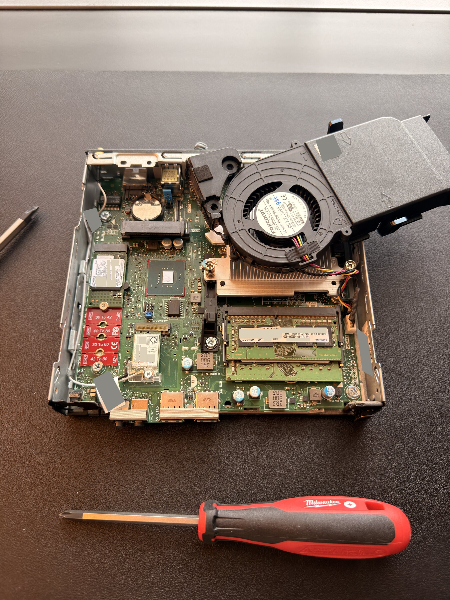
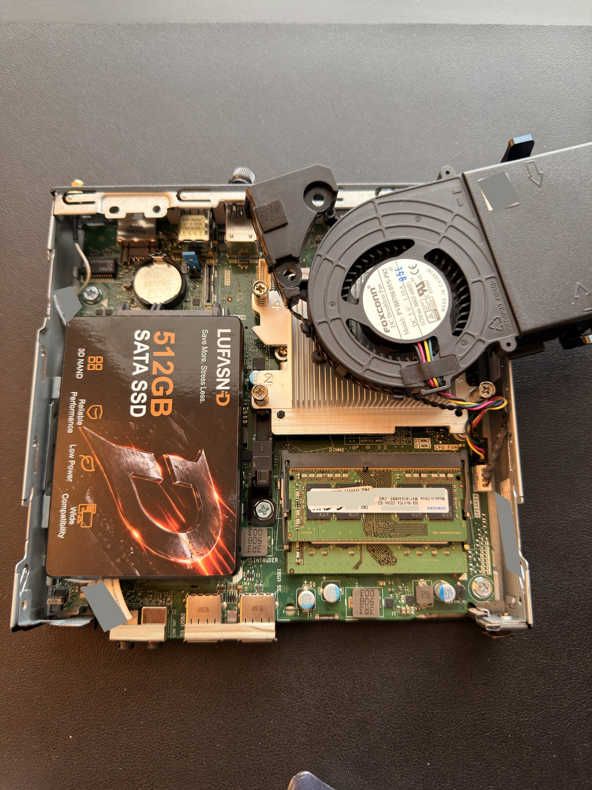
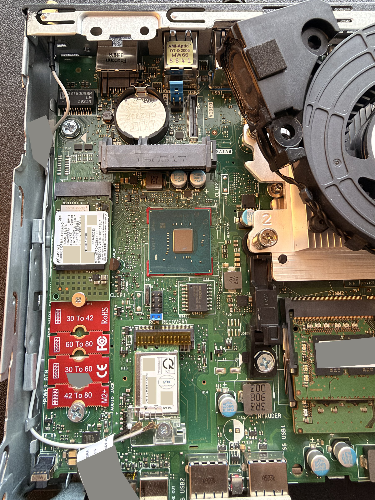
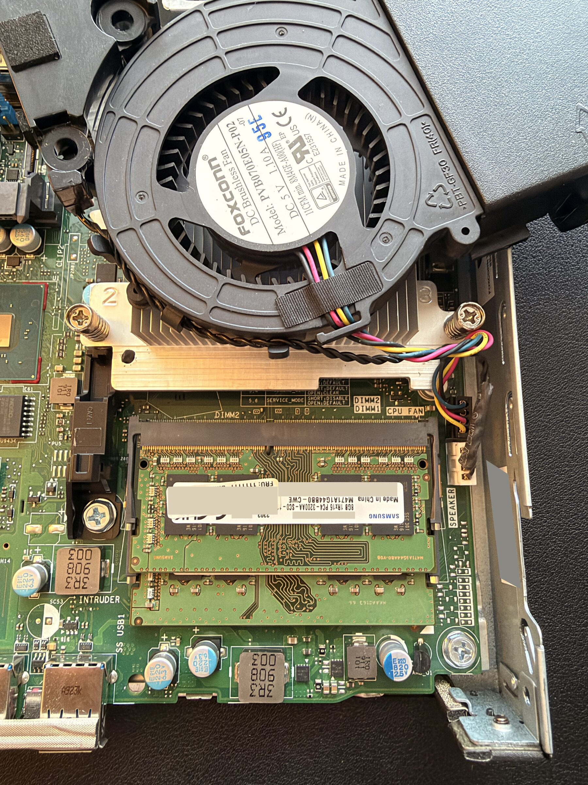

# Home Server

Documentation for my personal home server: hardware, setup, services, costs, and progress.

## Hardware

My home server runs on a Dell OptiPlex 3060 Micro powered by an Intel Core i3-8100T processor. Using parts salvaged from a heavily damaged Windows laptop that was no longer viable as a standalone server, I upgraded the base 8GB of DDR4 memory and 512GB SATA SSD by installing a matching memory module and a 512GB M.2 NVMe drive in the open expansion slots. This brings the system to 16GB of total RAM and 1TB of combined storage.

### Hardware photos

  
  

  
  

## Documentation

| File or folder | What belongs there |
| --- | --- |
| [Project brief](docs/project-brief.md) | Goals and decisions |
| [Hardware](docs/hardware.md) | Server reference, specifications, and connected equipment |
| [Parts and costs](docs/bill-of-materials.csv) | Equipment, quantities, and actual costs |
| [Build log](docs/build-log.md) | Dated progress, photos, problems, and next steps |
| [Validation](docs/validation.md) | Setup and service checks |
| [Services and known issues](docs/services.md) | Running services, auto-updates, and open hardware problems |
| [Photos](photos/README.md) | Hardware and setup photos |

## Costs

Running total of actual money spent: **$196.53**. Full line items in
[Parts and costs](docs/bill-of-materials.csv).

| Item | Cost | Notes |
| --- | --- | --- |
| Dell OptiPlex 3060 Micro (used) | $96.74 | i3-8100T, bought as 8 GB / 256 GB |
| 512 GB SATA SSD | $54.45 | Black Friday deal |
| 512 GB NVMe | Free | Salvaged |
| RAM +8 GB (to 16 GB) | Free | Salvaged |
| 90 W AC adapter | $17.99 | Power supply |
| VESA mount | $23.99 | Wall / under-desk |
| CMOS battery (CR2032) | $3.36 | Replaces the dead cell |
| **Total** | **$196.53** | |

## Milestones

- [x] Identify the server being used and link its listing.
- [x] Record the server specifications and connected equipment.
- [x] Photograph the starting setup.
- [x] Choose and document the operating system.
- [x] Set up the server and document installed services.
- [ ] Check access, storage, and backups as they are configured.
- [x] Record costs. (Results and lessons learned ongoing.)

## How I document progress

1. Add a dated build-log entry after each work session.
2. Add photos when the setup changes.
3. Update the hardware inventory and costs as equipment is added.
4. Commit a descriptive update, such as `Record server specifications` or `Document storage setup`.
5. Track the next steps in GitHub issues.
